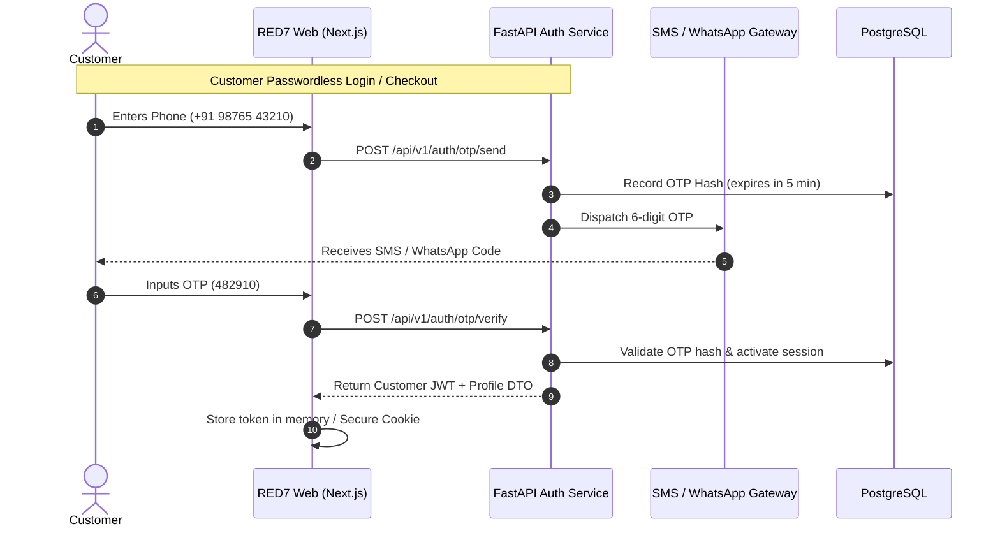

# RED7 Authentication & Role-Based Access Control (RBAC) Specification
**Version:** 1.0.0  
**Security Framework:** OAuth 2.0 / JWT (RFC 7519) + Phone OTP (E.164)

---

## 1. Authentication Architecture

RED7 implements a hybrid dual-flow authentication mechanism:
1. **Customer Frontline (Passwordless & Guest):** Mobile phone OTP via SMS / WhatsApp + anonymous guest session UUIDs (`X-Session-ID`).
2. **Backoffice Operations (High Security):** Email + Argon2id password hash + Time-based One-Time Password (TOTP) 2FA with short-lived JWT Access Tokens and HttpOnly Refresh Tokens.



---

## 2. Token Standards & Cryptographic Profiles

### 2.1 JWT Access Token (RFC 7519)
- **Algorithm:** `RS256` (Asymmetric RSA-SHA256) or `HS256` (HMAC-SHA256 with minimum 256-bit secret)
- **Expiration:** 15 minutes (`900` seconds)
- **Claims Schema:**
```json
{
  "iss": "https://api.red7.in",
  "sub": "usr-88291",
  "role": "customer",
  "tier": "VIP DROP CLUB",
  "phone": "+919876543210",
  "permissions": ["order:create", "order:read_self", "review:write"],
  "iat": 1759624200,
  "exp": 1759625100,
  "jti": "d3b07384-d113-4f44-8c88-7e44a4dfc299"
}
```

### 2.2 Refresh Token
- **Format:** High-entropy cryptographically secure random string (64 characters hex)
- **Storage:** Stored in database table `user_refresh_tokens` (hashed with SHA-256)
- **Cookie Attributes:**
  - `HttpOnly: true` (Inaccessible to browser JavaScript)
  - `Secure: true` (HTTPS only)
  - `SameSite: Strict`
  - `Path: /api/v1/auth`
  - `Max-Age: 604800` (7 days)

---

## 3. RBAC Role Definitions & Permission Matrix

### 3.1 Roles
1. **`guest` (Anonymous):** Any visitor browsing the storefront. Can search, read products, inspect sizes, and place guest orders with `X-Session-ID`.
2. **`customer` (Supporter):** Authenticated via phone OTP. Can view order history, save multiple delivery destinations, submit verified buyer reviews, and maintain a wishlist.
3. **`operations_manager` (Fulfillment):** Backoffice role. Can view orders, transition fulfillment status (`PLACED` -> `PACKED` -> `TRANSIT`), assign courier names and AWB tracking numbers.
4. **`catalog_manager` (Merchandise):** Backoffice role. Can create/edit products, manage variant inventory, upload gallery media, configure homepage hero copy and tickers.
5. **`super_admin` (Executive Owner):** Full root privileges including store settings (WhatsApp phone number, UPI VPA, COD limits, deleting reviews, staff accounts).

### 3.2 Permission Matrix

| Resource & Operation | `guest` | `customer` | `operations_manager` | `catalog_manager` | `super_admin` |
| :--- | :---: | :---: | :---: | :---: | :---: |
| **Catalog: Read Products & Categories** | Yes | Yes | Yes | Yes | Yes |
| **Catalog: Create / Edit / Delete Products** | No | No | No | Yes | Yes |
| **Inventory: Adjust Variant Stock** | No | No | Read Only | Yes | Yes |
| **Orders: Place New Order (Checkout)** | Yes | Yes | No | No | No |
| **Orders: View Self Order History** | Session | Yes | N/A | N/A | N/A |
| **Orders: View All Customer Orders** | No | No | Yes | Yes | Yes |
| **Orders: Update Status (`PACKED`, `TRANSIT`)** | No | No | Yes | No | Yes |
| **CMS: Edit Homepage Banners & Tickers** | No | No | No | Yes | Yes |
| **Media: Upload & Reassign Primary Image** | No | No | No | Yes | Yes |
| **Reviews: Submit Review** | No | Yes | No | No | Yes |
| **Reviews: Moderate / Delete Reviews** | No | No | No | No | Yes |
| **Promotions: Create & Pause Coupons** | No | No | No | Yes | Yes |
| **Settings: Edit WhatsApp, UPI & COD Config**| No | No | No | No | Yes |
| **Admin: View KPI Dashboard Metrics** | No | No | Yes | Yes | Yes |

---

## 4. Rate Limiting & Protection Rules

| Route / Capability | Window | Max Requests | Key Criterion |
| :--- | :--- | :--- | :--- |
| `POST /auth/otp/send` | 10 minutes | 3 attempts | Client IP + Phone Number |
| `POST /auth/otp/verify` | 15 minutes | 5 attempts | Session Token Hash |
| `POST /auth/admin/login` | 15 minutes | 5 attempts | Client IP + Email |
| `POST /checkout/orders` | 1 minute | 10 requests | `Idempotency-Key` + Client IP |
| `GET /search` | 1 minute | 60 requests | Client IP |
| `POST /media/upload-url` | 10 minutes | 20 uploads | Admin User ID |

---

## 5. Session Revocation & Blacklisting

1. **Logout:** When `POST /api/v1/auth/logout` is called:
   - The Refresh Token is purged from the database.
   - The JWT Access Token `jti` is pushed to Redis with TTL equal to the token's remaining lifespan.
   - The HTTP-only cookie is cleared with an expired date.
2. **Password Reset / Privilege Change:** Automatically revokes all existing refresh tokens for the given `user_id`.
