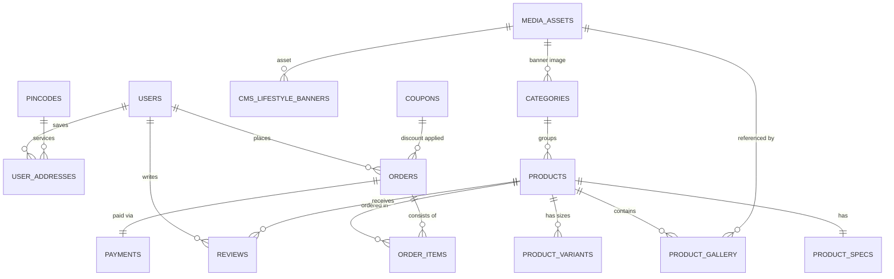

# RED7 PostgreSQL Database & Entity Specification
**Schema Version:** 1.0.0  
**Database Engine:** PostgreSQL 16+  
**Extensions Required:** `uuid-ossp`, `pg_trgm`, `btree_gin`

---

## 1. Entity-Relationship Overview



---

## 2. Custom Enumerations (ENUMs)

```sql
-- Garment sizing standard
CREATE TYPE kit_size_enum AS ENUM ('S', 'M', 'L', 'XL', '2XL');

-- Product department classifications
CREATE TYPE product_category_enum AS ENUM (
    'football-jerseys',
    'sportswear',
    'streetwear',
    'shoes',
    'accessories',
    'gadgets'
);

-- Fulfillment lifecycle states
CREATE TYPE order_status_enum AS ENUM (
    'PLACED',
    'PACKED',
    'TRANSIT',
    'DELIVERED',
    'CANCELLED'
);

-- Payment instrument types
CREATE TYPE payment_method_enum AS ENUM (
    'upi_intent',
    'upi_vpa',
    'card',
    'net_banking',
    'cod'
);

-- Targeted UPI native applications
CREATE TYPE upi_app_enum AS ENUM (
    'gpay',
    'phonepe',
    'paytm',
    'bhim'
);

-- Promotional voucher discount calculations
CREATE TYPE discount_type_enum AS ENUM (
    'percentage',
    'fixed'
);

-- Platform access roles
CREATE TYPE user_role_enum AS ENUM (
    'super_admin',
    'catalog_manager',
    'operations_manager',
    'customer',
    'guest'
);

-- Visual asset fallback category mapping
CREATE TYPE media_fallback_type_enum AS ENUM (
    'kit',
    'streetwear',
    'department',
    'hero',
    'avatar',
    'banner',
    'accessory'
);
```

---

## 3. Database Table Definitions

### 3.1 `users`
Master customer and backoffice administrator identities.
```sql
CREATE TABLE users (
    id VARCHAR(64) PRIMARY KEY, -- e.g. 'usr-88291' or UUID
    phone VARCHAR(20) UNIQUE,
    email VARCHAR(255) UNIQUE,
    full_name VARCHAR(120) NOT NULL,
    password_hash VARCHAR(255), -- NULL for phone-OTP customers
    role user_role_enum NOT NULL DEFAULT 'customer',
    member_tier VARCHAR(50) NOT NULL DEFAULT 'SUPPORTER', -- e.g. 'VIP DROP CLUB'
    is_active BOOLEAN NOT NULL DEFAULT TRUE,
    created_at TIMESTAMPTZ NOT NULL DEFAULT CURRENT_TIMESTAMP,
    updated_at TIMESTAMPTZ NOT NULL DEFAULT CURRENT_TIMESTAMP
);

CREATE INDEX idx_users_phone ON users(phone);
CREATE INDEX idx_users_email ON users(email);
CREATE INDEX idx_users_role ON users(role);
```

---

### 3.2 `user_addresses`
Saved destination addresses for customers.
```sql
CREATE TABLE user_addresses (
    id VARCHAR(64) PRIMARY KEY,
    user_id VARCHAR(64) NOT NULL REFERENCES users(id) ON DELETE CASCADE,
    full_name VARCHAR(120) NOT NULL,
    phone VARCHAR(20) NOT NULL,
    email VARCHAR(255),
    address_line1 TEXT NOT NULL,
    address_line2 TEXT,
    city VARCHAR(100) NOT NULL,
    state VARCHAR(100) NOT NULL,
    pincode VARCHAR(10) NOT NULL,
    is_default BOOLEAN NOT NULL DEFAULT FALSE,
    created_at TIMESTAMPTZ NOT NULL DEFAULT CURRENT_TIMESTAMP,
    updated_at TIMESTAMPTZ NOT NULL DEFAULT CURRENT_TIMESTAMP
);

CREATE INDEX idx_user_addresses_user_id ON user_addresses(user_id);
CREATE INDEX idx_user_addresses_pincode ON user_addresses(pincode);
```

---

### 3.3 `categories`
Top-level store departments matching the navigation drawer.
```sql
CREATE TABLE categories (
    id VARCHAR(64) PRIMARY KEY, -- e.g. 'cat-football-jerseys'
    slug VARCHAR(100) UNIQUE NOT NULL, -- 'football-jerseys'
    name VARCHAR(100) NOT NULL, -- 'Football Kits'
    tagline VARCHAR(255) NOT NULL, -- '26/27 Matchday Replicas & Retro Grails'
    item_count INTEGER NOT NULL DEFAULT 0,
    image_asset_id VARCHAR(64),
    featured BOOLEAN NOT NULL DEFAULT TRUE,
    sort_order INTEGER NOT NULL DEFAULT 0,
    created_at TIMESTAMPTZ NOT NULL DEFAULT CURRENT_TIMESTAMP,
    updated_at TIMESTAMPTZ NOT NULL DEFAULT CURRENT_TIMESTAMP
);

CREATE INDEX idx_categories_slug ON categories(slug);
```

---

### 3.4 `media_assets`
Central repository for all high-resolution photographic media.
```sql
CREATE TABLE media_assets (
    id VARCHAR(64) PRIMARY KEY, -- e.g. 'rm-away-1'
    url TEXT NOT NULL,
    alt VARCHAR(255) NOT NULL,
    width INTEGER,
    height INTEGER,
    blur_data_url TEXT,
    fallback_type media_fallback_type_enum NOT NULL DEFAULT 'kit',
    mime_type VARCHAR(50) DEFAULT 'image/jpeg',
    file_size_bytes INTEGER,
    storage_key VARCHAR(255), -- S3 / GCS object key
    created_at TIMESTAMPTZ NOT NULL DEFAULT CURRENT_TIMESTAMP
);

CREATE INDEX idx_media_assets_fallback ON media_assets(fallback_type);
```

---

### 3.5 `products`
Catalog items matching the RED7 frontend `Product` interface.
```sql
CREATE TABLE products (
    id VARCHAR(64) PRIMARY KEY, -- e.g. 'prod-rm-away-green'
    slug VARCHAR(150) UNIQUE NOT NULL,
    title VARCHAR(200) NOT NULL,
    short_title VARCHAR(100) NOT NULL,
    subtitle VARCHAR(255) NOT NULL,
    category product_category_enum NOT NULL DEFAULT 'football-jerseys',
    department VARCHAR(100) NOT NULL DEFAULT 'Football Kits',
    club VARCHAR(100), -- 'Real Madrid', 'AC Milan', etc.
    league VARCHAR(100), -- 'La Liga', 'Serie A', etc.
    price NUMERIC(10, 2) NOT NULL, -- 399.00
    original_price NUMERIC(10, 2), -- 2499.00
    discount_percent INTEGER GENERATED ALWAYS AS (
        CASE 
            WHEN original_price > price THEN ROUND(((original_price - price) / original_price) * 100)
            ELSE 0 
        END
    ) STORED,
    badge VARCHAR(50), -- 'DROP #01', '-11% OFF'
    drop_tag VARCHAR(50) DEFAULT 'AUTH MATCHDAY DROP',
    in_stock BOOLEAN NOT NULL DEFAULT TRUE,
    stock_count INTEGER NOT NULL DEFAULT 0,
    rating NUMERIC(2, 1) NOT NULL DEFAULT 5.0,
    reviews_count INTEGER NOT NULL DEFAULT 0,
    primary_image_id VARCHAR(64) NOT NULL REFERENCES media_assets(id),
    description TEXT NOT NULL,
    featured BOOLEAN NOT NULL DEFAULT FALSE,
    is_new_arrival BOOLEAN NOT NULL DEFAULT TRUE,
    search_vector TSVECTOR, -- Gin Full Text Search
    created_at TIMESTAMPTZ NOT NULL DEFAULT CURRENT_TIMESTAMP,
    updated_at TIMESTAMPTZ NOT NULL DEFAULT CURRENT_TIMESTAMP
);

-- Performance Indexes
CREATE INDEX idx_products_slug ON products(slug);
CREATE INDEX idx_products_category ON products(category);
CREATE INDEX idx_products_club ON products(club);
CREATE INDEX idx_products_price ON products(price);
CREATE INDEX idx_products_featured ON products(featured);
CREATE INDEX idx_products_is_new_arrival ON products(is_new_arrival);
CREATE INDEX idx_products_search_vector ON products USING GIN(search_vector);
CREATE INDEX idx_products_title_trgm ON products USING GIN (title gin_trgm_ops);
CREATE INDEX idx_products_club_trgm ON products USING GIN (club gin_trgm_ops);
```

---

### 3.6 `product_specs`
Technical construction specifications rendered in the PDP accordion.
```sql
CREATE TABLE product_specs (
    product_id VARCHAR(64) PRIMARY KEY REFERENCES products(id) ON DELETE CASCADE,
    material VARCHAR(200) NOT NULL DEFAULT 'Recycled Moisture-Wicking Poly',
    fit VARCHAR(100) NOT NULL DEFAULT 'Standard Fit',
    badges VARCHAR(200) NOT NULL DEFAULT 'High Density Patch',
    print VARCHAR(200) NOT NULL DEFAULT 'Official Supporter Grade',
    origin VARCHAR(100) DEFAULT 'Made in India',
    weight VARCHAR(50) DEFAULT '180 GSM'
);
```

---

### 3.7 `product_variants`
Size-specific inventory levels matching the 5 RED7 kit sizes (`S`, `M`, `L`, `XL`, `2XL`).
```sql
CREATE TABLE product_variants (
    id VARCHAR(64) PRIMARY KEY, -- e.g. 'prod-rm-away-green-M'
    product_id VARCHAR(64) NOT NULL REFERENCES products(id) ON DELETE CASCADE,
    size kit_size_enum NOT NULL,
    label VARCHAR(20) NOT NULL, -- '38"', '40"', '42"', '44"', '46"'
    stock INTEGER NOT NULL DEFAULT 0,
    in_stock BOOLEAN GENERATED ALWAYS AS (stock > 0) STORED,
    sku VARCHAR(100) UNIQUE,
    created_at TIMESTAMPTZ NOT NULL DEFAULT CURRENT_TIMESTAMP,
    updated_at TIMESTAMPTZ NOT NULL DEFAULT CURRENT_TIMESTAMP,
    CONSTRAINT uq_product_size UNIQUE (product_id, size)
);

CREATE INDEX idx_product_variants_product_id ON product_variants(product_id);
CREATE INDEX idx_product_variants_size ON product_variants(size);
```

---

### 3.8 `product_gallery`
Join table connecting products to multiple media assets.
```sql
CREATE TABLE product_gallery (
    id VARCHAR(64) PRIMARY KEY,
    product_id VARCHAR(64) NOT NULL REFERENCES products(id) ON DELETE CASCADE,
    media_asset_id VARCHAR(64) NOT NULL REFERENCES media_assets(id) ON DELETE CASCADE,
    sort_order INTEGER NOT NULL DEFAULT 0,
    is_primary BOOLEAN NOT NULL DEFAULT FALSE,
    created_at TIMESTAMPTZ NOT NULL DEFAULT CURRENT_TIMESTAMP,
    CONSTRAINT uq_product_media UNIQUE (product_id, media_asset_id)
);

CREATE INDEX idx_product_gallery_prod ON product_gallery(product_id);
```

---

### 3.9 `orders`
Master transaction and fulfillment record matching the frontend `Order` interface.
```sql
CREATE TABLE orders (
    id VARCHAR(64) PRIMARY KEY, -- e.g. 'ord-88291'
    allocation_id VARCHAR(64) UNIQUE NOT NULL, -- e.g. '#FYND-88291'
    user_id VARCHAR(64) REFERENCES users(id) ON DELETE SET NULL,
    guest_session_id VARCHAR(100),
    status order_status_enum NOT NULL DEFAULT 'PLACED',
    status_text VARCHAR(255) NOT NULL DEFAULT 'Drop Secured & Prioritized for Airline Dispatch',
    estimated_delivery VARCHAR(100) NOT NULL DEFAULT 'Thursday, by 3:00 PM',
    tracking_awb VARCHAR(100), -- 'BD88291IN'
    courier_name VARCHAR(100) DEFAULT 'Bluedart Express Priority',
    subtotal NUMERIC(10, 2) NOT NULL,
    discount NUMERIC(10, 2) NOT NULL DEFAULT 0.00,
    delivery_fee NUMERIC(10, 2) NOT NULL DEFAULT 0.00,
    total NUMERIC(10, 2) NOT NULL,
    payment_method VARCHAR(50) NOT NULL, -- 'GPAY Intent', 'COD'
    payment_ref VARCHAR(100) NOT NULL, -- 'UPI/26100588291'
    shipping_address_snapshot JSONB NOT NULL, -- Frozen snapshot of full address
    created_at TIMESTAMPTZ NOT NULL DEFAULT CURRENT_TIMESTAMP,
    updated_at TIMESTAMPTZ NOT NULL DEFAULT CURRENT_TIMESTAMP
);

CREATE INDEX idx_orders_allocation_id ON orders(allocation_id);
CREATE INDEX idx_orders_user_id ON orders(user_id);
CREATE INDEX idx_orders_status ON orders(status);
CREATE INDEX idx_orders_tracking_awb ON orders(tracking_awb);
CREATE INDEX idx_orders_created_at ON orders(created_at DESC);
```

---

### 3.10 `order_items`
Individual line items preserved inside an order.
```sql
CREATE TABLE order_items (
    id VARCHAR(64) PRIMARY KEY,
    order_id VARCHAR(64) NOT NULL REFERENCES orders(id) ON DELETE CASCADE,
    product_id VARCHAR(64) NOT NULL REFERENCES products(id),
    variant_id VARCHAR(64) REFERENCES product_variants(id),
    slug VARCHAR(150) NOT NULL,
    title VARCHAR(200) NOT NULL,
    subtitle VARCHAR(255),
    size VARCHAR(50) NOT NULL, -- 'M (UK/IN 40")'
    price NUMERIC(10, 2) NOT NULL,
    original_price NUMERIC(10, 2),
    quantity INTEGER NOT NULL DEFAULT 1,
    image_snapshot JSONB NOT NULL, -- MediaAsset snapshot
    created_at TIMESTAMPTZ NOT NULL DEFAULT CURRENT_TIMESTAMP
);

CREATE INDEX idx_order_items_order_id ON order_items(order_id);
CREATE INDEX idx_order_items_product_id ON order_items(product_id);
```

---

### 3.11 `payments`
Gateway and transaction ledger.
```sql
CREATE TABLE payments (
    id VARCHAR(64) PRIMARY KEY,
    order_id VARCHAR(64) NOT NULL REFERENCES orders(id) ON DELETE CASCADE,
    payment_method payment_method_enum NOT NULL,
    upi_app upi_app_enum,
    upi_vpa VARCHAR(100),
    gateway VARCHAR(50) NOT NULL DEFAULT 'NPCI_UPI', -- 'Razorpay', 'Cashfree', 'Manual_VPA'
    gateway_transaction_id VARCHAR(150),
    amount NUMERIC(10, 2) NOT NULL,
    currency VARCHAR(10) NOT NULL DEFAULT 'INR',
    status VARCHAR(50) NOT NULL DEFAULT 'INITIATED', -- 'PENDING', 'SUCCESS', 'FAILED'
    raw_response JSONB,
    created_at TIMESTAMPTZ NOT NULL DEFAULT CURRENT_TIMESTAMP,
    updated_at TIMESTAMPTZ NOT NULL DEFAULT CURRENT_TIMESTAMP
);

CREATE INDEX idx_payments_order_id ON payments(order_id);
CREATE INDEX idx_payments_gateway_tx ON payments(gateway_transaction_id);
```

---

### 3.12 `coupons`
Promotional discount vouchers.
```sql
CREATE TABLE coupons (
    id VARCHAR(64) PRIMARY KEY,
    code VARCHAR(50) UNIQUE NOT NULL, -- 'FLASH200', 'MADRIDISTA'
    title VARCHAR(150) NOT NULL,
    discount_type discount_type_enum NOT NULL DEFAULT 'fixed',
    discount_value NUMERIC(10, 2) NOT NULL,
    min_order_value NUMERIC(10, 2) NOT NULL DEFAULT 0.00,
    description TEXT,
    expiry_date DATE NOT NULL,
    is_active BOOLEAN NOT NULL DEFAULT TRUE,
    max_redemptions INTEGER,
    current_redemptions INTEGER NOT NULL DEFAULT 0,
    created_at TIMESTAMPTZ NOT NULL DEFAULT CURRENT_TIMESTAMP
);

CREATE INDEX idx_coupons_code ON coupons(UPPER(code));
CREATE INDEX idx_coupons_is_active ON coupons(is_active);
```

---

### 3.13 `reviews`
Verified purchaser testimonials.
```sql
CREATE TABLE reviews (
    id VARCHAR(64) PRIMARY KEY,
    product_id VARCHAR(64) REFERENCES products(id) ON DELETE SET NULL,
    user_id VARCHAR(64) REFERENCES users(id) ON DELETE SET NULL,
    author VARCHAR(100) NOT NULL,
    location VARCHAR(100) NOT NULL,
    rating INTEGER NOT NULL CHECK (rating >= 1 AND rating <= 5),
    comment TEXT NOT NULL,
    product_name VARCHAR(200) NOT NULL,
    verified_buyer BOOLEAN NOT NULL DEFAULT TRUE,
    is_approved BOOLEAN NOT NULL DEFAULT TRUE,
    created_at TIMESTAMPTZ NOT NULL DEFAULT CURRENT_TIMESTAMP
);

CREATE INDEX idx_reviews_product_id ON reviews(product_id);
CREATE INDEX idx_reviews_is_approved ON reviews(is_approved);
```

---

### 3.14 `pincodes`
National postal index logistics serviceability matrix.
```sql
CREATE TABLE pincodes (
    pincode VARCHAR(6) PRIMARY KEY,
    city VARCHAR(100) NOT NULL,
    state VARCHAR(100) NOT NULL,
    serviceable BOOLEAN NOT NULL DEFAULT TRUE,
    cod_available BOOLEAN NOT NULL DEFAULT TRUE,
    express_available BOOLEAN NOT NULL DEFAULT TRUE,
    hub_code VARCHAR(20),
    standard_delivery_days INTEGER DEFAULT 2
);

CREATE INDEX idx_pincodes_serviceable ON pincodes(serviceable);
```

---

### 3.15 `homepage_cms` & `cms_ticker_items`
Real-time dynamic editorial banners and ticker text.
```sql
CREATE TABLE homepage_cms (
    id VARCHAR(64) PRIMARY KEY DEFAULT 'current_homepage',
    hero_drop_badge VARCHAR(100) NOT NULL,
    hero_headline VARCHAR(200) NOT NULL,
    hero_subheadline TEXT NOT NULL,
    hero_cta_primary_text VARCHAR(50) NOT NULL DEFAULT 'EXPLORE KITS',
    hero_cta_primary_link VARCHAR(150) NOT NULL DEFAULT '/shop',
    hero_cta_secondary_text VARCHAR(50) NOT NULL DEFAULT 'VIEW DROPS',
    hero_cta_secondary_link VARCHAR(150) NOT NULL DEFAULT '/shop?sort=newest',
    hero_image_id VARCHAR(64) NOT NULL REFERENCES media_assets(id),
    hero_desktop_image_id VARCHAR(64) REFERENCES media_assets(id),
    flash_badge VARCHAR(100) NOT NULL,
    flash_headline VARCHAR(200) NOT NULL,
    flash_description TEXT NOT NULL,
    flash_button_text VARCHAR(50) NOT NULL DEFAULT 'CLAIM FREE DROP',
    flash_button_link VARCHAR(150) NOT NULL DEFAULT '/shop',
    updated_at TIMESTAMPTZ NOT NULL DEFAULT CURRENT_TIMESTAMP
);

CREATE TABLE cms_ticker_items (
    id VARCHAR(64) PRIMARY KEY,
    text VARCHAR(255) NOT NULL,
    is_highlight BOOLEAN NOT NULL DEFAULT FALSE,
    sort_order INTEGER NOT NULL DEFAULT 0,
    is_active BOOLEAN NOT NULL DEFAULT TRUE
);

CREATE TABLE cms_lifestyle_banners (
    id VARCHAR(64) PRIMARY KEY,
    title VARCHAR(150) NOT NULL,
    link VARCHAR(150) NOT NULL,
    media_asset_id VARCHAR(64) NOT NULL REFERENCES media_assets(id),
    sort_order INTEGER NOT NULL DEFAULT 0,
    is_active BOOLEAN NOT NULL DEFAULT TRUE
);
```

---

### 3.16 `store_settings`
Dynamic runtime configuration (WhatsApp, UPI, COD, Brand).
```sql
CREATE TABLE store_settings (
    key VARCHAR(100) PRIMARY KEY, -- 'whatsapp', 'upi', 'cod', 'logistics'
    value JSONB NOT NULL,
    description TEXT,
    updated_at TIMESTAMPTZ NOT NULL DEFAULT CURRENT_TIMESTAMP
);
```

#### Default Store Settings JSON Values:
- **`whatsapp` key value:**
```json
{
  "phoneNumber": "919876543210",
  "defaultMessage": "Hi RED7 Support, I have an inquiry about my drop order / sizing.",
  "isEnabled": true,
  "supportHours": "10:00 AM - 10:00 PM IST"
}
```
- **`upi` key value:**
```json
{
  "merchantVpa": "red7official@icici",
  "merchantName": "RED7 FOOTBALL APPAREL",
  "merchantCategoryCode": "5691",
  "staticQrUrl": "https://cdn.red7.in/payments/upi-merchant-qr.png"
}
```
- **`cod` key value:**
```json
{
  "isEnabled": true,
  "maxOrderValue": 5000.00,
  "requireOtp": true,
  "blacklistedPincodes": []
}
```

---

## 4. Automatic Database Triggers

### 4.1 Automated Stock Count Synchronization
When individual `product_variants.stock` changes, recalculate `products.stock_count` and `products.in_stock`:
```sql
CREATE OR REPLACE FUNCTION sync_product_stock()
RETURNS TRIGGER AS $$
BEGIN
    UPDATE products
    SET 
        stock_count = (SELECT COALESCE(SUM(stock), 0) FROM product_variants WHERE product_id = NEW.product_id),
        in_stock = (SELECT COALESCE(SUM(stock), 0) > 0 FROM product_variants WHERE product_id = NEW.product_id),
        updated_at = CURRENT_TIMESTAMP
    WHERE id = NEW.product_id;
    RETURN NEW;
END;
$$ LANGUAGE plpgsql;

CREATE TRIGGER trg_sync_product_stock
AFTER INSERT OR UPDATE OR DELETE ON product_variants
FOR EACH ROW EXECUTE FUNCTION sync_product_stock();
```

### 4.2 Automated Full-Text Search Vector Generation
```sql
CREATE OR REPLACE FUNCTION sync_product_search_vector()
RETURNS TRIGGER AS $$
BEGIN
    NEW.search_vector := 
        setweight(to_tsvector('english', COALESCE(NEW.title, '')), 'A') ||
        setweight(to_tsvector('english', COALESCE(NEW.club, '')), 'A') ||
        setweight(to_tsvector('english', COALESCE(NEW.subtitle, '')), 'B') ||
        setweight(to_tsvector('english', COALESCE(NEW.department, '')), 'C') ||
        setweight(to_tsvector('english', COALESCE(NEW.description, '')), 'D');
    RETURN NEW;
END;
$$ LANGUAGE plpgsql;

CREATE TRIGGER trg_sync_product_search_vector
BEFORE INSERT OR UPDATE ON products
FOR EACH ROW EXECUTE FUNCTION sync_product_search_vector();
```
