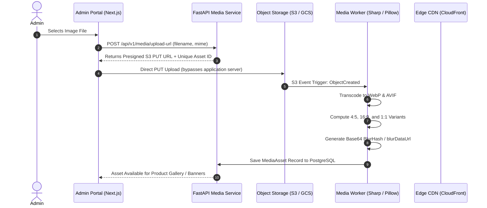

# RED7 Media Pipeline, CDN & Asset Specification
**Version:** 1.0.0  
**Storage Architecture:** Amazon S3 / Google Cloud Storage + CloudFront / Cloudflare Edge CDN

---

## 1. Architecture Overview

RED7 relies on high-resolution lifestyle, product, and matchday photography. To deliver sub-second page loads on mobile networks, media assets are processed through an automated serverless ingestion pipeline:



---

## 2. Presigned Upload Endpoint

### 2.1 Request Upload URL
- **Method & Route:** `POST /api/v1/media/upload-url`
- **Auth:** Admin Bearer Token
- **Request Body:**
```json
{
  "filename": "arsenal-home-saka.jpg",
  "mimeType": "image/jpeg",
  "sizeBytes": 2451920,
  "fallbackType": "kit"
}
```
- **Validation:**
  - `mimeType`: Must be in `['image/jpeg', 'image/png', 'image/webp', 'image/avif']`.
  - `sizeBytes`: Maximum 10MB (`10485760` bytes).
- **Response `200 OK`:**
```json
{
  "assetId": "img-26100588291",
  "uploadUrl": "https://storage.red7.in/uploads/raw/img-26100588291.jpg?AWSAccessKeyId=AKIA...&Signature=...",
  "publicUrl": "https://cdn.red7.in/products/img-26100588291.webp",
  "expiresInSeconds": 300
}
```

---

## 3. Image Optimization & Responsive Formats

| Asset Type | Target Aspect Ratio | Dimensions (WxH) | Formats Generated |
| :--- | :--- | :--- | :--- |
| **PDP Main & Gallery** | `4:5` (Vertical Portrait) | `1000x1250 px` | WebP, AVIF, JPEG |
| **Mobile Hero Banner** | `3:4` or `9:16` | `1080x1440 px` | WebP, AVIF |
| **Desktop Hero Banner**| `16:9` / Ultra-wide | `1920x1080 px` | WebP, AVIF |
| **Thumbnail / Grid Mini**| `1:1` Square | `400x400 px` | WebP |
| **Category Department**| `4:5` | `800x1000 px` | WebP |

### 3.1 BlurHash & `blurDataUrl` Generation
Every uploaded asset automatically receives an inline base64 data URL (e.g. `data:image/svg+xml;base64,...`) allowing the Next.js `<Image placeholder="blur" />` component to render an instantaneous placeholder before network fetch completes.

### 3.2 Presentation Roles: Primary Card Hero vs. Side-Swipe Carousel
- **Hero Image (`isPrimary: true`):** The primary showcase image used for product cards, search results, category department thumbnails, and the initial active slide (`Slide 1`) on the PDP.
- **Side-Swipe Gallery Images (`gallery: MediaAsset[]`):** Side-swipeable carousel photos on the Product Detail Page (PDP) with touch swipe, slide counter pill (`1 / 4`), dot progress indicators, and clickable mini-thumbnails. Admin can promote any side-swipe image to "Primary" at any time.

---

## 4. Universal Fallback Hierarchy

To ensure the storefront UI **never breaks or displays broken image icons**, the backend and frontend adhere to the `MediaFallbackType` enum contract:

| Fallback Type | Fallback Asset Path | Semantic Context |
| :--- | :--- | :--- |
| `'kit'` | `https://cdn.red7.in/fallbacks/kit-placeholder.webp` | Football shirts, retro jerseys, matchday kits |
| `'streetwear'` | `https://cdn.red7.in/fallbacks/streetwear-placeholder.webp`| Hoodies, track pants, oversized tees |
| `'department'` | `https://cdn.red7.in/fallbacks/department-placeholder.webp`| Category cards in navigation drawer |
| `'hero'` | `/images/hero-reference.png` | Landing page editorial showcase |
| `'avatar'` | `https://cdn.red7.in/fallbacks/avatar-placeholder.webp` | Supporter and customer profiles |
| `'banner'` | `https://cdn.red7.in/fallbacks/banner-placeholder.webp` | Flash sales & promotional strips |
| `'accessory'` | `https://cdn.red7.in/fallbacks/accessory-placeholder.webp` | Hats, socks, terrace scarves |

---

## 5. CDN Caching & Edge Invalidation

1. **Immutable Storage:** Uploaded assets are saved with content-hashed URLs (e.g. `/media/assets/img-rm-away-261005.webp`).
2. **Cache-Control Header:**
   ```
   Cache-Control: public, max-age=31536000, immutable
   ```
3. **Invalidation Hooks:** When an admin calls `PUT /api/v1/products/{id}/gallery/primary` or updates homepage CMS banners, the backend triggers an automated CDN purge for `/api/v1/products/{slug}` and `/api/v1/cms/homepage`.
