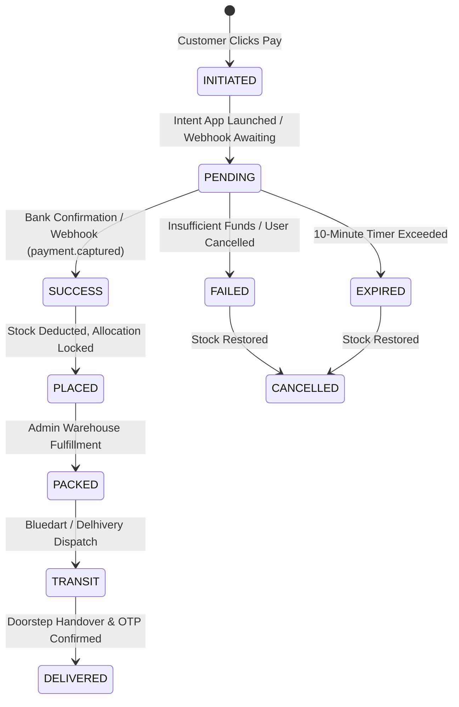

# RED7 Payment Systems & Logistics Specification
**Version:** 1.0.0  
**Primary Gateway Rails:** NPCI UPI (Unified Payments Interface), Razorpay / Cashfree Gateway, Cash on Delivery (COD)

---

## 1. Payment Methods Overview

The RED7 checkout UI supports three primary payment flows:
1. **UPI Native Intent (GPay, PhonePe, Paytm, BHIM):** Instant device deep-linking with zero gateway fee.
2. **Manual UPI ID / VPA Verification:** Direct payment requests pushed to customer UPI apps.
3. **Cash on Delivery (COD):** Serviceable PIN code verification with OTP confirmation at checkout / doorstep.
4. **Credit / Debit Cards & Net Banking:** Secondary fallback modal backed by 3D-Secure 2.0.

---

## 2. UPI Deep-Link Intent Protocol

### 2.1 Standard URI Specification
When a customer clicks GPay, PhonePe, Paytm, or BHIM on mobile, the backend generates an RFC-compliant UPI Intent URI:

```
upi://pay?pa={merchant_vpa}&pn={payee_name}&mc={merchant_category_code}&tid={order_id}&tr={allocation_id}&tn={drop_memo}&am={total_amount}&cu=INR
```

### 2.2 Parameters
| Key | Value Example | Description |
| :--- | :--- | :--- |
| `pa` | `red7official@icici` | Registered merchant Virtual Payment Address (VPA) |
| `pn` | `RED7 FOOTBALL APPAREL` | Payee display name registered with NPCI |
| `mc` | `5691` | Merchant Category Code (Apparel / Retail) |
| `tid` | `FYND88291` | Internal unique transaction ID |
| `tr` | `88291` | Transaction Reference Number |
| `tn` | `Drop Reservation FYND88291` | Transaction note displayed in customer bank app |
| `am` | `399.00` | Exact payable order amount |
| `cu` | `INR` | Currency code |

### 2.3 App-Specific Deep Links
- **Google Pay:** `gpay://upi/pay?pa=...`
- **PhonePe:** `phonepe://pay?pa=...`
- **Paytm:** `paytmmp://pay?pa=...`
- **Universal / BHIM:** `upi://pay?pa=...`

---

## 3. Dynamic & Static UPI QR Codes

For desktop checkout or manual scanning, the backend dynamically generates a Base64-encoded PNG QR code containing the UPI intent string.
- **Resolution:** 512x512 px.
- **Error Correction:** Level M (15% redundancy).
- **Embedded Logo:** RED7 brand crest centered.

---

## 4. Cash on Delivery (COD) Rules Engine

Cash on Delivery is governed by three strict risk rules:
1. **PIN Code Serviceability:** The destination 6-digit PIN code must have `pincodes.cod_available = TRUE`.
2. **Order Value Ceiling:** Order total must be `<= store_settings.cod.maxOrderValue` (default: ₹5,000.00).
3. **Delivery OTP Verification:** A 4-digit PIN is sent to the customer upon delivery handover to prevent fraudulent returns.

---

## 5. Order Reservation Timer & Expiry Lifecycle

As rendered on the frontend (`DROP RESERVATION: 07:42 REMAINING`):
1. **Inventory Hold:** When an order is initialized via `POST /api/v1/checkout/orders`, the variant stock is temporarily held in a reserved state for **10 minutes** (`600` seconds).
2. **Payment Confirmation:** If a successful payment webhook or bank settlement is received within 10 minutes:
   - Order transitions to `status = 'PLACED'`.
   - Inventory reservation is permanently deducted from `product_variants.stock`.
3. **Timeout Expiry:** If no payment is secured within 10 minutes:
   - Order transitions to `status = 'CANCELLED'`.
   - Held inventory is automatically released back to the live storefront catalog.

---

## 6. Payment Webhook State Machine & Reconciliation



### 6.1 Webhook Endpoint
- **Method & Route:** `POST /api/v1/checkout/webhook/{gateway}`
- **Security:** HMAC-SHA256 signature verification via header `X-Razorpay-Signature` or `X-Gateway-Signature`
- **Idempotency:** Webhook event IDs are stored in a dedicated `payment_webhooks` table; duplicate event deliveries return `200 OK` without re-processing.
